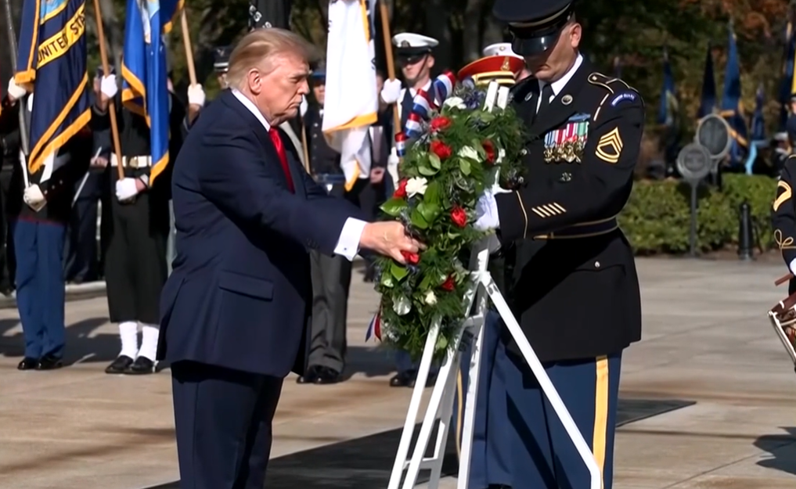

**Trump Declares ‘We Won’ Iran War at Veterans Day Ceremony, Demands ‘Total Victory’**

President Donald Trump used a Veterans Day address at Arlington National Cemetery on Wednesday to claim that the United States has already won its war with Iran, while insisting the conflict must end only with “total victory” rather than a partial outcome.

Speaking at the Memorial Amphitheater after laying a wreath at the Tomb of the Unknown Soldier, Trump told veterans and their families: “America did not start a war with Iran. Iran has been waging war on America since 1979. This should have been taken care of a long time ago.” He continued: “It was about time somebody fought back. All of us fought back. We fought back, and we seriously fought back, and we won. Just a question of when we want to end it. We want to make sure we have a total victory, not a 93% victory.”

Trump said U.S. operations against Iran began seven months earlier, with only a few weeks of intense fighting. He acknowledged the human cost, stating, “We lost 18 beautiful souls,” and predicted the conflict would end “soon,” leaving the world “much safer, a better place, more peaceful place.” He also claimed it would take Iran 25 years to rebuild what American forces had destroyed.

The remarks came eight days after midterm elections in which Democrats gained control of both chambers of Congress, a result Trump has linked in part to public dissatisfaction with the war. The speech blended tributes to veterans with a defense of the administration’s military campaign, which Trump framed as a long-overdue response to decades of Iranian aggression.
