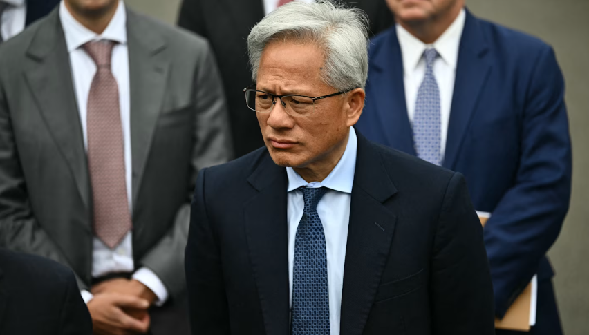

**Nvidia shares plunge as board weighs ousting CEO Jensen Huang amid dual affair scandals**

Nvidia shares tumbled more than 8% in after-hours trading on Wednesday after reports that the chip giant’s board is preparing to remove longtime CEO and co-founder Jensen Huang, intensifying a leadership crisis that has already wiped hundreds of billions from the company’s market value.

The Wall Street Journal first reported that directors were weighing Huang’s ouster and could meet as soon as Wednesday to decide his future. The move marks a sharp reversal from earlier in the week, when the board expressed confidence in Huang while launching an independent investigation. Nvidia has no obvious internal successor after more than three decades under Huang’s leadership, raising concerns about a potential vacuum at the company powering much of the global AI boom.

### What triggered the board’s shift
Huang admitted in a Sunday memo to employees that he had been unfaithful to his wife and took “full responsibility,” without naming partners. The company simultaneously announced a board-led probe into whether he had been targeted by a foreign intelligence operation linked to Alice Huang (no relation), a Chinese business executive whom U.S. intelligence agencies reportedly view as a suspected asset of China’s Ministry of State Security.

On Wednesday, The New York Times reported a second extramarital relationship—with Kimberly Powell, Nvidia’s vice president of healthcare, who reports to Huang—citing multiple people who worked at the company. The combination of personal misconduct allegations and national-security questions appears to have forced the board’s hand. Under Nvidia’s bylaws, a majority of directors can remove an officer, including the CEO, with or without cause. Nvidia has 11 directors and considers all but Huang independent.

Shares fell more than 8% after hours (one report put the decline at over 9% at one point), extending a steep weekly drop. Including the after-hours move, Nvidia has lost roughly $600 billion in market value this week since the investigation was announced. Earlier estimates put the damage since late October closer to $450–$1 trillion depending on the timeframe. Analysts note that Huang is widely viewed as central to Nvidia’s strategy, culture, and customer relationships in AI chips.

### Succession uncertainty and market reaction
Huang, 63, co-founded Nvidia in 1993 and owns about 3.6% of the stock. He maintains dozens of direct reports, underscoring his unusually tight control. Bloomberg reported that the board has already been working with an outside firm to identify potential replacements and is considering an interim CEO. Names floated in analyst commentary include longtime CFO Colette Kress for an interim role, though longer-term technology leadership remains an open question. Prediction markets such as Polymarket showed sharply higher odds of Huang resigning or being removed by year-end.

Wall Street reaction has been cautious. Some analysts warn that an abrupt departure could create further volatility because Nvidia lacks a clear public succession plan. Others note the board’s duty to investigate thoroughly, especially given the national-security overlay and congressional interest. The Trump administration is reportedly aware of the board’s deliberations.

Nvidia has not immediately commented on the latest board-meeting reports. The independent investigation continues under outside counsel, including partners from the elite firm Wachtell, Lipton, Rosen & Katz. Any permanent replacement would likely require an external search given the depth of Huang’s involvement in the company’s technical roadmap and industry relationships.

The situation remains fluid. Investors and the broader AI sector are watching closely for the board’s decision, which could reshape leadership at one of the world’s most valuable technology companies.
