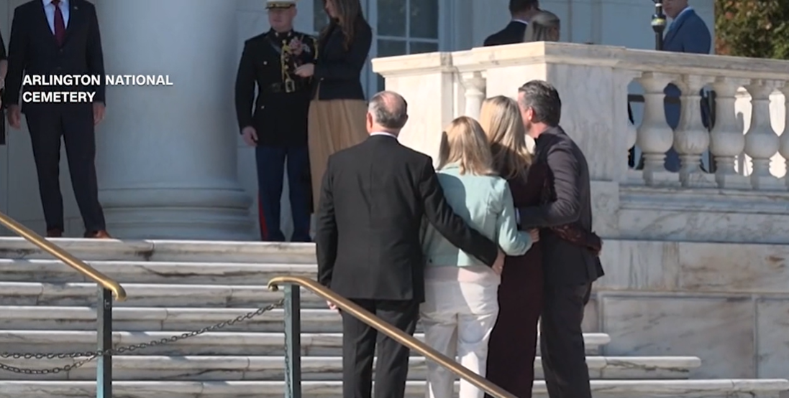

**Army Sentinel Reprimands Defense Secretary Pete Hegseth and Aides for Laughing at Tomb of the Unknown Soldier**

U.S. Defense Secretary Pete Hegseth and members of his team were publicly admonished by an Army sentinel at the Tomb of the Unknown Soldier on Veterans Day after laughter and conversation disrupted the expected silence and respect at the sacred Arlington National Cemetery memorial.

Video from the November 11, 2026, ceremony shows Hegseth posing for photos on the steps in front of the tomb with his wife, Jennifer, chief of staff Ricky Buria, deputy chief of staff Patrick Weaver, and senior adviser Tami Radabaugh following the formal wreath-laying event attended by President Donald Trump and Vice President JD Vance. As the group broke from the photos and began walking away, a loud laugh and talking were audible. The sentinel on duty stopped his patrol, turned toward them, and called out: “All visitors will maintain an atmosphere of silence and respect at all times.”

Hegseth looked over his shoulder toward the guard before continuing up the steps. The Tomb of the Unknown Soldier, one of the nation’s most solemn war memorials, honors unidentified service members from World War I, World War II, and the Korean War. A member of the 3rd U.S. Infantry Regiment (The Old Guard) has guarded it around the clock since 1948. Cemetery rules require visitors to speak quietly and avoid any disorderly or disrespectful conduct.

Chief Pentagon Spokesman Sean Parnell addressed the incident, stating: “While commemorating this solemn day, a soldier correctly and respectfully reminded everyone to maintain decorum. The Secretary and the entire Department have always honored—and will always honor—the sacrifices our military men and women have made to keep America safe.”

The moment occurred one day after Hegseth narrowly survived a House impeachment effort. The video of the exchange circulated widely, drawing attention to the strict etiquette enforced at the site regardless of visitors’ rank.
